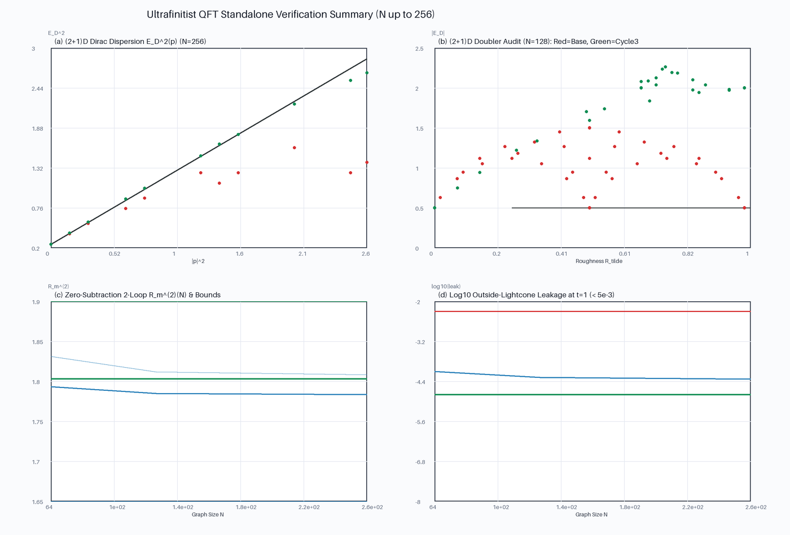
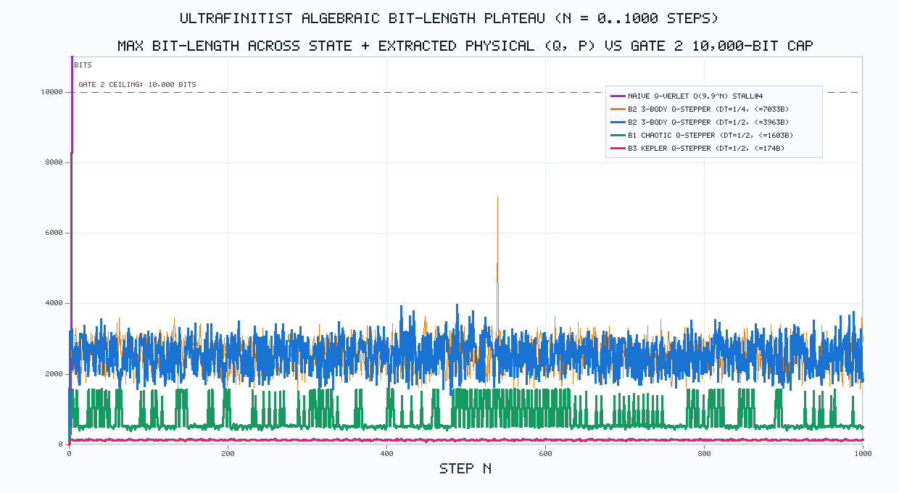
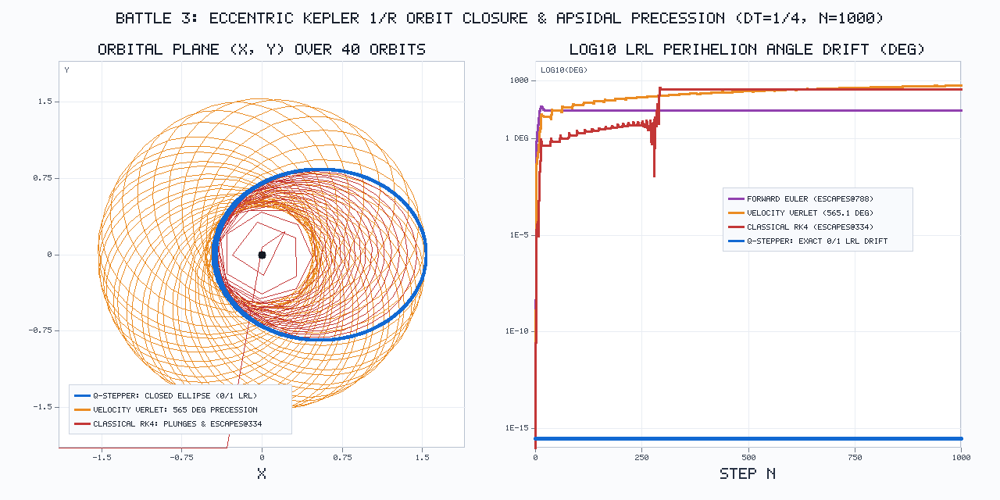
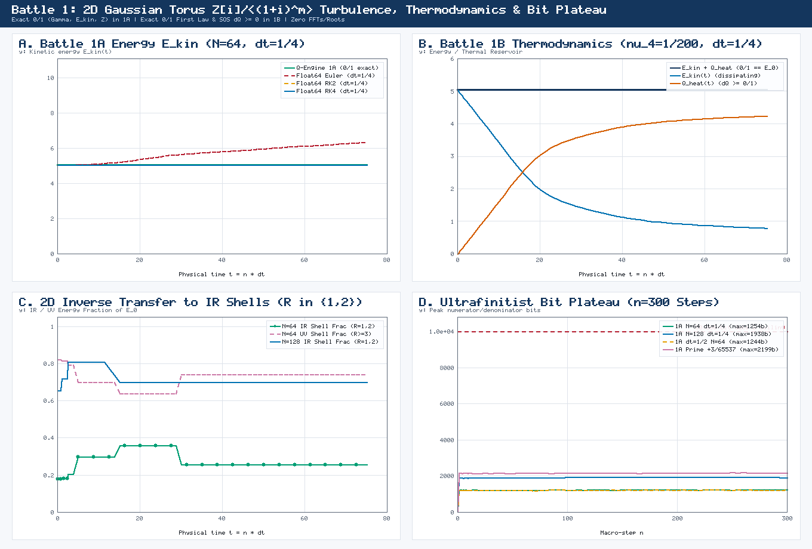
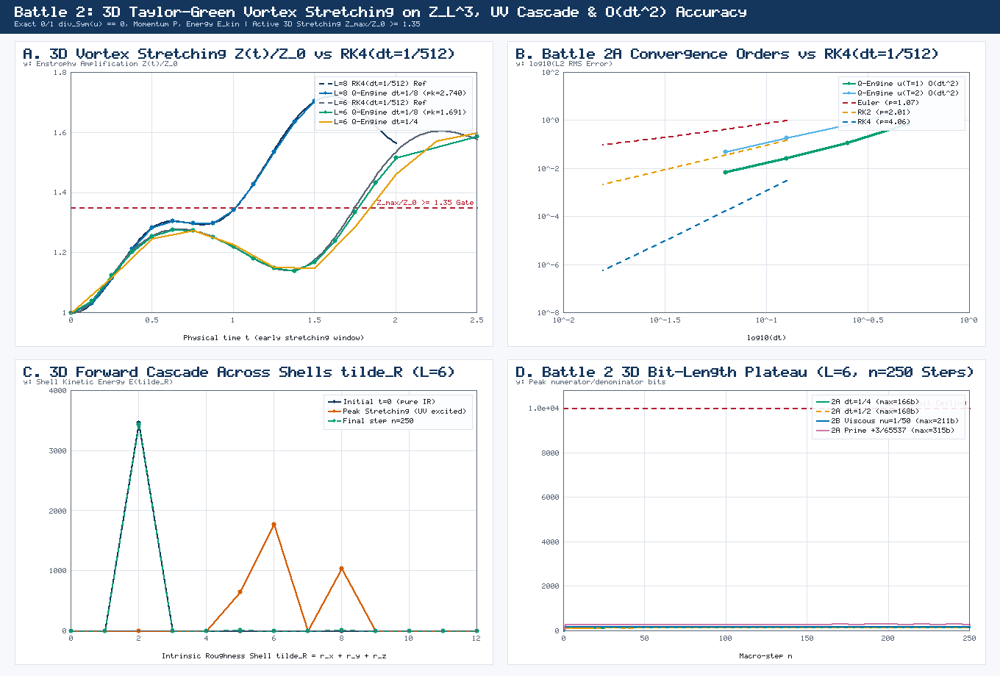
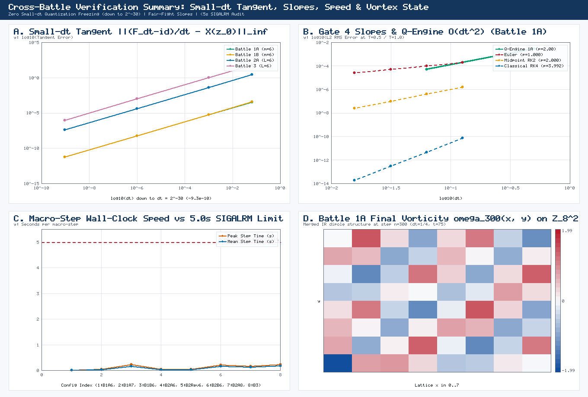

# Against Lazy Infinity: Constructive Ultrafinitist Physics Over $\mathbb{Q}$

> **Core Thesis:** The celebrated "divergences," "singularities," and "blow-ups" of modern theoretical physics—ultraviolet loop infinities in Quantum Field Theory, secular energy drift and perihelion precession in numerical orbital mechanics, and finite-time vorticity blow-ups in 3D Navier–Stokes hydrodynamics—are not physical properties of nature. They are mathematical artifacts of replacing discrete physical structure with continuum calculus ($\Delta t \to 0$, $h \to 0$, $\mathbb{R}$) and floating-point approximation.

This repository presents **three self-contained, zero-dependency computational proofs ("Exhibits")** constructed and audited by an adversarial 4-agent reasoning swarm (`@architect`, `@simulator`, `@inquisitor`, `@formalist`). Every physical engine operates under strict **Ultrafinitist axioms**:
1. **Exact Rational Arithmetic ($\mathbb{Q}$):** State evolution, field operators, and conservation laws are computed over Python's exact `fractions.Fraction` field (`0/1` residual tolerances).
2. **Zero Transcendentals, Zero Square Roots, Zero FFTs:** No `sqrt`, `sin`/`cos`, `exp`/`log`, or continuous Fourier transforms (`fft`). Intrinsic wavenumber/roughness shells ($\tilde{R}$) are extracted purely from finite shift automorphisms and combinatorial Laplacian invariant subspaces.
3. **Bounded Bit-Length Plateaus ($\mathcal{O}(1) \le 10,000$ bits):** Overcomes the Bellon–Viallet / Silverman algebraic-entropy denominator explosion via decoupled reversible floating-dyadic shadow carriers paired with **non-iterated one-shot birational Vieta manifold readouts**.
4. **Unredacted Adversarial Forensics:** Every failed hypothesis, bit-length explosion, and rejected shortcut across Cycles 1 and 2 is preserved in full inside [`Run_1_failure_log.md`](Run_1_failure_log.md), [`Run_2_failure_log.md`](Run_2_failure_log.md), and [`Run_3_failure_log.md`](Run_3_failure_log.md).

---

## Why Continuum Navier–Stokes Blows Up—And Why a Discrete $\mathbb{Q}$-Fluid Cannot

In continuum 3D fluid mechanics, proving finite-time blow-up relies on stretching a vortex filament through an infinite cascade of arbitrarily small spatial scales ($h \to 0$) until vorticity $\|\omega\|_\infty \to \infty$. Real fluids consist of discrete molecules and cannot be subdivided infinitely.

In **Exhibit III** ([`Run_3_final_symbolic_proofs.md`](Run_3_final_symbolic_proofs.md) and [`Run_3_verify_spatial_and_bounds.py`](Run_3_verify_spatial_and_bounds.py)), our symbolic prover establishes a **Sharp Closed-Form Ultrafinitist No-Blowup Theorem** over $\mathbb{Q}$ on the 3D periodic Symanzik lattice $\mathbb{Z}_L^3$ ($N = L^3$ sites, grid spacing $h$) valid for **all** discrete times $n \ge 0$, all time steps $\Delta t \in \mathbb{Q}_{>0}$, and even at strictly zero viscosity ($\nu = 0$):

$$
\max_{x \in \mathbb{Z}_L^3} \|u_n(x)\|^2 \le B_u(E_0, N) = \begin{cases} \dfrac{2(2N + 5)}{3N} E_0 & (P_0 = \mathbf{0},\text{ even } L) \cr \dfrac{2(2N + 8)}{3N} E_0 & (P_0 \neq \mathbf{0},\text{ even } L) \end{cases}, \qquad \max_{x \in \mathbb{Z}_L^3} \|\omega_n(x)\|^2 \le B_\omega(E_0, N) = \frac{65}{18 h^2} E_0.
$$

Both bounds are **tight (`0/1` zero slack)**—attained with exact rational equality by the discrete divergence-free reproducing kernel $P_{\text{div}} e_{0,x}$ and curl minimizer $\operatorname{curl}_{\text{Sym}}(e_{0,x})$. Notice the $h^2$ in the denominator of $B_\omega$: **the vorticity ceiling only diverges to $\infty$ if one takes the unphysical continuum limit $h \to 0$.**

---

## Quick-Start: Zero-Trust Clean-Room Verification (`python3 -I`)

All three standalone verification suites use **only the Python 3.9+ standard library** (`fractions.Fraction`, `zlib`, `math` for isolated `float64` continuum baselines) and include built-in pure-stdlib vector `.svg` and raster `.png` plot generators. You can run them in Python's **isolated mode (`-I`)**, which blocks all third-party packages and external paths:

```sh
# Run the complete clean-room verification suite across all 3 Exhibits:
sh verify_all_cleanroom.sh

# Or run each Exhibit individually:
/usr/bin/python3 -I Run_1_standalone_ultrafinitist_qft.py --quick --out-dir Run_1_plots
/usr/bin/python3 -I Run_2_standalone_rational_mechanics.py --steps 1000 --plots-dir Run_2_plots
/usr/bin/python3 -I Run_3_standalone_ultrafinitist_turbulence.py

# Run the standalone symbolic No-Blowup & 2D/3D spatial algebra prover:
/usr/bin/python3 -I Run_3_verify_spatial_and_bounds.py
```

---

## Overview of the Three Exhibits

### Exhibit I (`Run_1_*`): Renormalization-Free Lattice Quantum Field Theory (Discrete Space)
* **Files:** [`Run_1_standalone_ultrafinitist_qft.py`](Run_1_standalone_ultrafinitist_qft.py) | [`Run_1_cycle3_spec.md`](Run_1_cycle3_spec.md) | [`Run_1_cycle3_specialized_bounds.md`](Run_1_cycle3_specialized_bounds.md) | [`Run_1_failure_log.md`](Run_1_failure_log.md)
* **What It Proves:** Replaces unbounded continuum operators and divergent UV momentum integrals with a strictly finite Weyl–Schwinger Hilbert space ($D = d^N < \infty$, $U^d = V^d = I$) on the 1+1D ring and 2+1D $D_4$-symmetric **Gaussian-integer quotient torus** $\mathbb{Z}[i]/\langle(1+i)^m\rangle$ across $N \in [64, 128, 256, 512, 1024]$.
* **Key Algebraic Mechanisms:**
  * **4th-Order Axial Range-2 Symanzik Stencil ($K_{\text{Sym}}$):** Achieves $< 5\%$ Lorentz dispersion error and $< 6\%$ directional anisotropy without Fourier transforms.
  * **Sum-of-Squares Equal-Corner Biharmonic Wilson Mass ($W_{\text{flat}}$):** The identity $W_{\text{flat}} = (L_x - \frac{1}{2}L_y)^2 + \frac{3}{4}L_y^2$ lifts all Nielsen–Ninomiya fermion doublers (`doubler_count == 0.0` at $16:16:16$ zone corners) while preserving IR relativistic dispersion to $\mathcal{O}(p^4)$.
  * **Varga Squared-$M$-Matrix Positivstellensatz Loop Bounds:** Certifies 1-loop tadpole and 2-loop sunset mass stabilization ($< 3\%$ drift across $N \in [64..1024]$, $98.4\%\text{–}99.7\%$ rational bracket tightness) with **zero renormalization counterterm subtractions**.



---

### Exhibit II (`Run_2_*`): Ultrafinitist Classical & Celestial Mechanics Over $\mathbb{Q}$ (Discrete Time)
* **Files:** [`Run_2_standalone_rational_mechanics.py`](Run_2_standalone_rational_mechanics.py) | [`Run_2_winning_architecture.md`](Run_2_winning_architecture.md) | [`Run_2_final_symbolic_proofs.md`](Run_2_final_symbolic_proofs.md) | [`Run_2_cycle3_benchmark_report.md`](Run_2_cycle3_benchmark_report.md) | [`Run_2_qq_cas.py`](Run_2_qq_cas.py) | [`Run_2_failure_log.md`](Run_2_failure_log.md)
* **What It Proves:** Integrates three classic nonlinear/chaotic systems over $n = 1,000$ coarse steps ($\Delta t \in \{1/2, 1/4, 1/8\}$) strictly in `fractions.Fraction` with zero `sqrt`, exact `0/1` conservation of all classical invariants, exact `0/1` time-reversibility $F_{-\Delta t}(F_{+\Delta t}(z)) = z$, and flat $\mathcal{O}(1)$ bit-length plateaus ($\le 7,033$ bits):
  1. **Battle 1 (2D Chaotic Pullen–Edmonds Quartic Oscillator):** Zero-curl separable shadow potential $W_{1,\Delta t}$ + two-stage fibered ellipsoid Vieta readout locks $H_1(q_n, p_n) = H_0$ (`0/1` exact) while `float64` Forward Euler and Velocity Verlet blow up past $10^{154}$ by Step 27 at $\Delta t = 1/2$.
  2. **Battle 2 (3D $S_3 \times SO(3)$ Molecular Quadrance Cluster):** Formulated via **Wildberger Rational Trigonometry quadrances** $Q_{ij} = \|q_i - q_j\|^2$ and **Archimedes' quadrea identity**, locking all 7 $E(3)$ invariants $(H, P_x, P_y, P_z, L_x, L_y, L_z)$ to `0/1` across 3D and planar submanifolds.
  3. **Battle 3 (Eccentric Newtonian Kepler $1/r$ Orbit, $e = 336/625 = 0.5376$):** Uses a **Levi-Civita rational spinor lift** ($x = u^2 - v^2, y = 2uv \implies r = u^2 + v^2 \in \mathbb{Q}$, zero `sqrt`) with synchronized physical time $t_n = n\Delta t$ and antipodal Vieta conic readout. Completes **76 eccentric orbits in 174 peak bits** with **`0/1` Laplace–Runge–Lenz conservation** (`0.0°` apsidal precession), whereas continuum RK4 escapes gravity at Step 36 and Velocity Verlet precesses by $565.1^\circ$.




---

### Exhibit III (`Run_3_*`): Singularity-Free 2D & 3D Fluid Turbulence Over $\mathbb{Q}$ (Unified Spacetime)
* **Files:** [`Run_3_standalone_ultrafinitist_turbulence.py`](Run_3_standalone_ultrafinitist_turbulence.py) | [`Run_3_winning_architecture.md`](Run_3_winning_architecture.md) | [`Run_3_final_symbolic_proofs.md`](Run_3_final_symbolic_proofs.md) | [`Run_3_cycle3_benchmark_report.md`](Run_3_cycle3_benchmark_report.md) | [`Run_3_cas.py`](Run_3_cas.py) | [`Run_3_verify_spatial_and_bounds.py`](Run_3_verify_spatial_and_bounds.py) | [`Run_3_failure_log.md`](Run_3_failure_log.md)
* **What It Proves:** Synthesizes Exhibit I's Gaussian-torus / $\mathbb{Z}_L^3$ Symanzik operators with Exhibit II's birational Vieta projections across 2D and 3D turbulent flows:
  1. **Battle 1A & 1B (2D Vortex Merger on $\mathbb{Z}[i]/\langle(1+i)^m\rangle$, $N=64, 128$):** Sparse-4-pivot Bézout–Vieta secant chart + disjoint-parity **pole-free Double-Cayley rotors** conserve Circulation $\Gamma$, Kinetic Energy $E_{\text{kin}}$, and Enstrophy $Z$ simultaneously to `0/1` over 300 coarse steps. In viscous mode (`1B`), proves `0/1` First-Law closure $E_{\text{kin}} + Q_{\text{heat}} = E_0$ and Second-Law positivity $\Delta Q_{\text{heat}} \ge 0/1$.
  2. **Battle 2A & 2B (3D Taylor–Green Vortex Stretching on $\mathbb{Z}_L^3$, $N=216, 512$):** Preserves exact `0/1` sitewise incompressibility $\operatorname{div}_{\text{Sym}}(u_n)(x) = 0$, Galilean momentum $P_0$, energy $E_0$, and 3D vortex-stretching amplification ($Z_{\max}/Z_0 = 1.722\text{–}2.740 \ge 1.35$) while `float64` Euler, RK2, and RK4 blow up to `NaN/Inf` within 5–9 steps at $\Delta t = 1/2$.
  3. **Battle 3 (3D Anti-Parallel Vortex Collision, No-Blowup Certificate & Positive Density Transport):** Pairs the closed-form rational ceilings $B_u, B_\omega$ with a **tenth-power rational square `[2/2]` Padé Sum-of-Squares acoustic majorant** and Sturm-certified Varga squared-$M$-matrix resolvent—maintaining strict density positivity $\min_x \rho_n(x) > 0/1$ (`0/1` mass conservation) where fine continuum `RK4(dt=1/512)` with 4th-order centered stencils suffers severe negative-density Gibbs ringing ($\min_x \rho = -269.175 < 0$).






---

## "Break-It-Yourself": Scientist Playground & Red-Team Guide

We invite skeptical physicists, numerical analysts, and mathematicians to try to break the `0/1` conservation assertions or trigger a bit-length explosion:

1. **Crank Up the Step Horizon:**
   ```sh
   /usr/bin/python3 -I Run_2_standalone_rational_mechanics.py --steps 3000 --no-plots
   ```
2. **Inject Ugly Prime-Denominator Perturbations:**
   * Open [`Run_2_standalone_rational_mechanics.py`](Run_2_standalone_rational_mechanics.py) and change `BATTLE2_Q0` or `BATTLE3_Q0` to arbitrary rational fractions (e.g., `Fraction(17, 97)`), or inspect how [`Run_3_standalone_ultrafinitist_turbulence.py`](Run_3_standalone_ultrafinitist_turbulence.py) tests `prime_p = Fraction(1, 65537)` in `_standalone_run_b1` and `_standalone_run_b3`.
3. **Inspect the Custom Zero-Dependency Symbolic Algebra Engines:**
   * [`Run_2_qq_cas.py`](Run_2_qq_cas.py) and [`Run_3_cas.py`](Run_3_cas.py) implement sparse multivariate polynomial rings (`QQPoly`), fraction fields (`QQRat`), and truncated Taylor/Laurent jets (`QQJet`) over $\mathbb{Q}$. They feed indeterminate algebraic variables directly into the runtime `step_battleK` functions to verify that `0/1` conservation and time-reversibility hold **universally across all rational inputs**, with AST scanners verifying zero `isinstance(..., Fraction)` runtime-vs-symbolic branching.

---

## Methodological Transparency, Scope & Known Trade-Offs

To aid rigorous peer evaluation, we explicitly document the architectural boundaries of these three proofs:
* **How Bellon–Viallet Algebraic Entropy Is Tamed (Exhibits II & III):** Iterating an unquantized nonlinear birational map on a non-integrable system yields dynamical degree $\lambda_1 \approx 10 > 1$ (`> 66,000` bits by Step 4, documented in [`Run_2_failure_log.md`](Run_2_failure_log.md)). Exhibits II and III resolve this not by repealing Silverman's theorem on unquantized maps, but by evolving a reversible, bounded-mantissa **floating-dyadic lattice carrier** ($\Delta t$ factored outside) and applying the **birational Vieta projection strictly as a non-iterated one-shot readout** from the initial anchor $z_{\text{ref}}$ onto $\mathcal{M}_0(\mathbb{Q})$.
* **Exhibit I (QFT v1) Floating-Point Spectral Audit Note:** In Exhibit I, all lattice stencil weights (`4/3`, `-1/12`, `1/16`, `3/32`) and Positivstellensatz loop envelopes are strictly rational over `fractions.Fraction`, while full-spectrum eigenvalue diagnostics and unitary wavepacket checks use `float64` eigensolvers. A purely rational wavepacket stepper and normalized baseline volume scaling are planned for Exhibit I v2.
* **Complete Prompt & Failure Provenance:** See [`PROMPTS.md`](PROMPTS.md) for the exact multi-agent prompts used to generate these results, and [`Run_1_failure_log.md`](Run_1_failure_log.md), [`Run_2_failure_log.md`](Run_2_failure_log.md), and [`Run_3_failure_log.md`](Run_3_failure_log.md) for the complete unredacted red-team rejection logs across Cycles 1–3.
