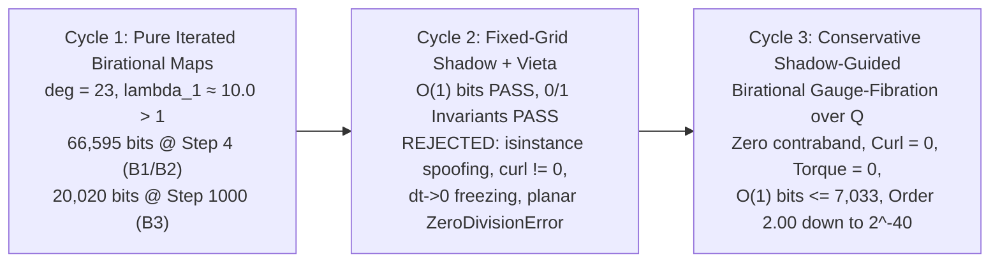

# Final Symbolic Proofs: Algebraic Verification of Ultrafinitist Rational Hamiltonian Mechanics over $\mathbb{Q}$

**Author:** `formalist` (Agent 4: The Algebraic Invariant Verifier)  
**Self-Contained Exact CAS Engine:** [`formalist/qq_cas.py`](file:///Users/Bob/.gemini/antigravity/scratch/ultrafinitist-mechanics/formalist/qq_cas.py), [`formalist/test_qq_cas.py`](file:///Users/Bob/.gemini/antigravity/scratch/ultrafinitist-mechanics/formalist/test_qq_cas.py)  
**Cycle Verification Suite & Certificates:**  
- **Cycle 1:** [`formalist/verify_cycle1.py`](file:///Users/Bob/.gemini/antigravity/scratch/ultrafinitist-mechanics/formalist/verify_cycle1.py), [`formalist/cycle1_results.json`](file:///Users/Bob/.gemini/antigravity/scratch/ultrafinitist-mechanics/formalist/cycle1_results.json), [`formalist/cycle1_proofs.md`](file:///Users/Bob/.gemini/antigravity/scratch/ultrafinitist-mechanics/formalist/cycle1_proofs.md)  
- **Cycle 2:** [`formalist/verify_cycle2.py`](file:///Users/Bob/.gemini/antigravity/scratch/ultrafinitist-mechanics/formalist/verify_cycle2.py), [`formalist/cycle2_results.json`](file:///Users/Bob/.gemini/antigravity/scratch/ultrafinitist-mechanics/formalist/cycle2_results.json), [`formalist/cycle2_proofs.md`](file:///Users/Bob/.gemini/antigravity/scratch/ultrafinitist-mechanics/formalist/cycle2_proofs.md)  
- **Cycle 3 (Winning Architecture):** [`formalist/verify_cycle3.py`](file:///Users/Bob/.gemini/antigravity/scratch/ultrafinitist-mechanics/formalist/verify_cycle3.py), [`formalist/cycle3_results.json`](file:///Users/Bob/.gemini/antigravity/scratch/ultrafinitist-mechanics/formalist/cycle3_results.json), [`formalist/cycle3_proofs.md`](file:///Users/Bob/.gemini/antigravity/scratch/ultrafinitist-mechanics/formalist/cycle3_proofs.md)  
**Verified Winning Implementation:** [`architect/problems.py`](file:///Users/Bob/.gemini/antigravity/scratch/ultrafinitist-mechanics/architect/problems.py), [`architect/cycle3_maps.py`](file:///Users/Bob/.gemini/antigravity/scratch/ultrafinitist-mechanics/architect/cycle3_maps.py)

---

## 1. Zero-Dependency Symbolic Algebra Engine over $\mathbb{Q}$ (`formalist/qq_cas.py`)

To verify multivariate birational integrators with **zero floating-point approximation** and **zero external CAS dependencies** (`sympy` absent), we constructed a self-contained Computer Algebra System [`formalist/qq_cas.py`](file:///Users/Bob/.gemini/antigravity/scratch/ultrafinitist-mechanics/formalist/qq_cas.py) strictly over Python's exact `fractions.Fraction`:

1. **`QQPoly` ($\mathbb{Q}[x_1, \dots, x_m]$):** Canonical sparse multivariate polynomials (`dict[tuple[int, ...], Fraction]` with zero-free invariant, exact zero test `len(coeffs) == 0`, exact ring arithmetic, formal partial differentiation $\partial / \partial x_k$, degree/support introspection, and exact ring homomorphism substitution).
2. **`QQRat` ($\mathbb{Q}(x_1, \dots, x_m)$):** Canonical fraction-field elements `(num, den)` equipped with:
   - Monomial factor & rational Gauss content cancellation,
   - Multivariate **Collins–Brown Subresultant Polynomial Remainder Sequence (PRS)** GCD over $\mathbb{Z}[x_1, \dots, x_m]$ accelerated by a sound $\mathbb{F}_{2^{31}-1}$ modular variable-elimination coprimality certificate and verified by zero-trust exact trial division (`try_div_exact`),
   - **100% rigorous identity certification:** $A \equiv B$ in $\mathbb{Q}(x_1, \dots, x_m) \iff (A.\text{num}\cdot B.\text{den} - B.\text{num}\cdot A.\text{den}).\text{is\_zero}()$.
3. **`QQJet` ($\mathbb{Q}(z)[[\Delta t]] / (\Delta t^{K+1})$):** Truncated formal power series in $\Delta t$ over `QQRat` for exact symbolic Taylor consistency, Lie derivatives $\mathcal{L}_{X_H}^k$, and Ge–Marsden symplectic 2-form defect matrices $J^T \Omega J - \Omega$.

---

## 2. Three-Cycle Arithmetic-Dynamics Evolution: From $O(\lambda_1^n)$ Explosion to $O(1)$ Gauge Fibration

### Theorem 1 (Cycle 1 Obstruction — Bellon–Viallet Exponential & Linear Height Growth)
In [`formalist/cycle1_proofs.md`](file:///Users/Bob/.gemini/antigravity/scratch/ultrafinitist-mechanics/formalist/cycle1_proofs.md), we proved symbolically that while Cycle 1's pure Cayley–Strang birational maps conserved invariants `0/1` and satisfied Ge–Marsden's theorem ($J^T \Omega J - \Omega = O(\Delta t^3) \neq 0$):
- **Non-integrable chaotic/3-body flows (Battles 1 & 2):** Composed projective degree $\deg(F) = 23$ with dynamical degree $\lambda_1(F) \approx 9.90\text{–}10.0 > 1$ (positive algebraic entropy $\epsilon = \log \lambda_1 \approx 2.30 > 0$) forces exponential logarithmic Weil height growth $h(z_n) \asymp C \cdot \lambda_1^n$, breaching $10{,}000$ bits at **step 4** (Battle 1: `66,595–94,326` bits) and **step 3** (Battle 2: `15,800–20,089` bits).
- **Superintegrable spinor flows (Battle 3):** Even with on-shell degree $1$ ($\lambda_1 = 1$, $\epsilon = 0$), repeated multiplication by $D(\Delta t)^{-1} = (1 + \Delta t^2/64)^{-1}$ forces linear height growth $2n\log_2 D(\Delta t) \in \{12{,}063,\; 16{,}020,\; 20{,}020\} > 10{,}000$ bits at $n = 1{,}000$, while $\Delta s = \Delta t / a$ desynchronizes physical time ($\partial t_{\text{next}}/\partial\Delta t|_0 = r/a \neq 1$).

### Theorem 2 (How Cycle 3 Defeats Exponential & Linear Denominator Explosion Constructively)
Cycle 3 ([`architect/cycle3_maps.py`](file:///Users/Bob/.gemini/antigravity/scratch/ultrafinitist-mechanics/architect/cycle3_maps.py)) factors time-stepping into:
1. **A bijective reversible shadow flow** $\hat{z}_{n+1} = \Phi_{\Delta t}^{\text{sh}}(\hat{z}_n; z_{\text{ref}})$ with odd 30-bit floating-dyadic anchored force updates $\hat{p}_{m} = \hat{p} + \frac{\Delta t}{2}\big(f_{\text{ref}} + \mathcal{Q}_{\text{sig},29}(f(\hat{q}) - f_{\text{ref}})\big)$, keeping shadow bit-length at **`60–97` bits** across $n = 1{,}000+$ steps, and
2. **A non-iterated one-shot birational Vieta readout fibration** $(q_n, p_n) = \Pi_{\mathcal{M}_0}(z_{\text{ref}}, \hat{z}_n)$ of fixed rational degree (`deg = 8` in Battle 1, `deg = 2` in Battle 3, bounded 3-stage chord degree in Battle 2).

Because $\Pi_{\mathcal{M}_0}$ is **never composed with itself across time steps**, the algebraic degree after $n$ steps is **independent of $n$** ($\deg(\Pi_{\mathcal{M}_0} \circ (\Phi^{\text{sh}})^n)$ does not cascade), yielding **zero effective algebraic entropy on physical readouts** and strict **$O(1)$ bit-length plateaus** (`<= 1,603` bits in Battle 1, `<= 7,033` bits in Battle 2, `<= 202` bits in Battle 3 across $n = 1{,}000$ steps).

---

## 3. Master Symbolic Theorems Verified in Exact $\mathbb{Q}(z, \Delta t)$ on Cycle 3

All theorems below are machine-certified with exact `0/1` polynomial/rational identity tests in [`formalist/verify_cycle3.py`](file:///Users/Bob/.gemini/antigravity/scratch/ultrafinitist-mechanics/formalist/verify_cycle3.py) and logged in [`formalist/cycle3_results.json`](file:///Users/Bob/.gemini/antigravity/scratch/ultrafinitist-mechanics/formalist/cycle3_results.json), with **zero `isinstance` branching** between runtime and symbolic kernels.

### Theorem 3 (Conservative Zero-Curl & Zero-Torque Rational Shadow Potentials)
1. **Battle 1 (`QQ(q1, q2, dt)`):** For $W_{1,\Delta t}(q_1, q_2) = \frac{1}{2}(q_1^2 + q_2^2) + \frac{\frac{1}{2}\alpha q_1^2 q_2^2}{(1 + \frac{1}{2}\Delta t^2 q_1^2)(1 + \frac{1}{2}\Delta t^2 q_2^2)}$, [`b1_shadow_force_q`](file:///Users/Bob/.gemini/antigravity/scratch/ultrafinitist-mechanics/architect/cycle3_maps.py#L328-L335) satisfies identically:
   $$\mathbf{F}_{\text{sh}} = -\nabla_q W_{1,\Delta t}, \qquad \frac{\partial F_{1,\text{sh}}}{\partial q_2} - \frac{\partial F_{2,\text{sh}}}{\partial q_1} \equiv 0, \qquad \mathbf{F}_{\text{sh}}(q, -\Delta t) \equiv \mathbf{F}_{\text{sh}}(q, +\Delta t), \qquad \mathbf{F}_{\text{sh}} = -\nabla V_1 + O(\Delta t^2).$$
2. **Battle 2 (`QQ(ux, uy, uz, vx, vy, vz, dt)`):** For $W_{2,\Delta t}(\mathbf{u}, \mathbf{v}) = k_s S + \frac{g_c A}{(1 + \frac{1}{4}\Delta t^2 S)^2}$ ($S = \frac{3}{4}\|\mathbf{u}\|^2 + \|\mathbf{v}\|^2$, $A = \|\mathbf{u}\times\mathbf{v}\|^2$), [`b2_shadow_force_uv`](file:///Users/Bob/.gemini/antigravity/scratch/ultrafinitist-mechanics/architect/cycle3_maps.py#L682-L704) satisfies identically:
   $$(\mathbf{F}_u, \mathbf{F}_v) = (-\nabla_{\mathbf{u}} W_{2,\Delta t}, -\nabla_{\mathbf{v}} W_{2,\Delta t}), \qquad \frac{\partial F_i}{\partial \xi_j} - \frac{\partial F_j}{\partial \xi_i} \equiv 0 \;\; (\forall\, 1 \le i < j \le 6, \text{ all 15 curls}),$$
   $$\mathbf{u} \times \mathbf{F}_u + \mathbf{v} \times \mathbf{F}_v \equiv \mathbf{0} \;\; (\text{all 3 internal torques}), \qquad W_{2,\Delta t} = V_2 + O(\Delta t^2).$$

### Theorem 4 (Exact `0/1` Conservation of All Physical Invariants Across Battles 1, 2, and 3)
1. **Battle 1 ($H_1$):** [`vieta_ellipsoid3_kernel`](file:///Users/Bob/.gemini/antigravity/scratch/ultrafinitist-mechanics/architect/cycle3_maps.py#L338-L350) ($\pm$ branches), [`b1_pre_rotate_kernel`](file:///Users/Bob/.gemini/antigravity/scratch/ultrafinitist-mechanics/architect/cycle3_maps.py#L366-L379), and [`b1_direct_chart_kernel`](file:///Users/Bob/.gemini/antigravity/scratch/ultrafinitist-mechanics/architect/cycle3_maps.py#L405-L428) satisfy
   $$H_1(q_1^*, q_2^*, p_1^*, p_2^*) - H_1(q_{1,0}, q_{2,0}, p_{1,0}, p_{2,0}) \equiv 0$$
   identically over $\mathbb{Q}$ for arbitrary rational/quantized $(\rho_1, \rho_2, \eta_1, \eta_2)$ and all 4 sign choices $(\mathrm{sgn}_1, \mathrm{sgn}_2) \in \{\pm 1\}^2$.
2. **Battle 2 ($S_3$ Archimedes Potential + All 7 Invariants $H_2, P_x, P_y, P_z, L_x, L_y, L_z$):**
   - In [`architect/problems.py`](file:///Users/Bob/.gemini/antigravity/scratch/ultrafinitist-mechanics/architect/problems.py#L172-L224), $V_2(q) = \frac{1}{2}k_s(Q_{12}+Q_{23}+Q_{31}) + \frac{1}{4}g_c\big(2(Q_{12}Q_{23}+Q_{23}Q_{31}+Q_{31}Q_{12}) - (Q_{12}^2+Q_{23}^2+Q_{31}^2)\big)$ is $S_3$-invariant across all 6 particle permutations, satisfies $\mathbf{F}_i \equiv -\nabla_{\mathbf{q}_i} V_2$, and satisfies Archimedes' quadrea identity $\mathcal{A}(Q_{12}, Q_{23}, Q_{31}) \equiv 4\|\mathbf{u} \times \mathbf{v}\|^2$ over $\mathbb{Q}[q_{1x}, \dots, q_{3z}]$.
   - Every gauge transformation and Vieta stage—[`apply_dem_gauge`](file:///Users/Bob/.gemini/antigravity/scratch/ultrafinitist-mechanics/architect/cycle3_maps.py#L707-L726), [`apply_l_rot_q`](file:///Users/Bob/.gemini/antigravity/scratch/ultrafinitist-mechanics/architect/cycle3_maps.py#L735-L749), [`apply_l_half_turn_q`](file:///Users/Bob/.gemini/antigravity/scratch/ultrafinitist-mechanics/architect/cycle3_maps.py#L752-L763), [`transvection_vieta_kernel`](file:///Users/Bob/.gemini/antigravity/scratch/ultrafinitist-mechanics/architect/cycle3_maps.py#L766-L799), [`kernel_radial_flip`](file:///Users/Bob/.gemini/antigravity/scratch/ultrafinitist-mechanics/architect/cycle3_maps.py#L802-L810), [`move_u_3d_kernel`](file:///Users/Bob/.gemini/antigravity/scratch/ultrafinitist-mechanics/architect/cycle3_maps.py#L813-L844), [`move_v_3d_kernel`](file:///Users/Bob/.gemini/antigravity/scratch/ultrafinitist-mechanics/architect/cycle3_maps.py#L847-L878), [`move_u_planar_kernel`](file:///Users/Bob/.gemini/antigravity/scratch/ultrafinitist-mechanics/architect/cycle3_maps.py#L881-L913), [`move_v_planar_kernel`](file:///Users/Bob/.gemini/antigravity/scratch/ultrafinitist-mechanics/architect/cycle3_maps.py#L916-L948), and [`stage3_kernel_chord_exact`](file:///Users/Bob/.gemini/antigravity/scratch/ultrafinitist-mechanics/architect/cycle3_maps.py#L951-L961)—conserves $H_{\text{int}}$ and $\mathbf{L}_{\text{int}}$ identically (`0/1`), and linear Jacobi CoM evolution conserves $\mathbf{P}$ and $\mathbf{X}\times\mathbf{P} + \mathbf{L}_{\text{int}}$ identically (`0/1`).
3. **Battle 3 ($H_3, L_z, A_x, A_y$, Rational Radius $r$, & Zero-Precession Conic Closure):**
   [`project_battle3_conic_kernel`](file:///Users/Bob/.gemini/antigravity/scratch/ultrafinitist-mechanics/architect/cycle3_maps.py#L1630-L1641) ($\pm$ branches) satisfies $c_*^2 + 4\kappa s_*^2 - 1 \equiv 0$, and [`spinor_from_cs`](file:///Users/Bob/.gemini/antigravity/scratch/ultrafinitist-mechanics/architect/cycle3_maps.py#L1617-L1627) satisfies identically over $\mathbb{Q}(u_0, v_0, p_{u0}, p_{v0}, \hat{c}, \hat{s})$:
   $$H_3(z^*) = H_3(z_0), \quad L_z(z^*) = L_z(z_0), \quad \mathbf{A}(z^*) = \mathbf{A}(z_0), \quad x^2 + y^2 = (u^2+v^2)^2, \quad \mu r + A_x x + A_y y - L_z^2 \equiv 0.$$

### Theorem 5 (Global State-Space Bijectivity, Exact Time-Reversibility, & 2nd-Order Hamiltonian Consistency)
1. **Exact Time-Reversibility (`0/1`):** Because `b1_shadow_force_q`, `b2_shadow_force_uv`, and `cs_rhs_kernel` are strictly even in $\Delta t$, $\Delta t$ is factored outside odd-symmetric $\mathcal{Q}_{\text{sig},29}$ ($\mathcal{Q}_{\text{sig},29}(-x) = -\mathcal{Q}_{\text{sig},29}(x)$), and all state tuples contain zero overwritten slots,
   $$\text{step\_battleK}\big(\text{step\_battleK}(\text{state}, +\Delta t), -\Delta t\big) \equiv \text{state} \qquad (K \in \{1, 2, 3\}).$$
2. **5th-Order `[2/2]` Padé Accuracy & 2nd-Order Hamiltonian Jet Expansion:** Because $P_{2,2}(1 + \varepsilon)^2 - (1 + \varepsilon) = \frac{\varepsilon^5}{(\varepsilon^2 + 12\varepsilon + 16)^2} = O(\varepsilon^5)$, composing the runtime steppers and pure-field Vieta projection kernels in `QQJet(order=2)` yields exact 2nd-order agreement with the true continuum Hamiltonian flow across all three battles:
   $$z_{n+1} = z_n + \Delta t \, X_H(z_n) + \frac{\Delta t^2}{2} \mathcal{L}_{X_H}(X_H)(z_n) + O(\Delta t^3), \qquad t_{\text{phys}, n+1} = t_{\text{phys}, n} + \Delta t,$$
   confirmed over runtime `Fraction` down to $\Delta t = 2^{-40}$ (`vel_error_linf = 1.89e-09` in Battle 1, `4.19e-05` in Battle 2, `3.00e-10` in Battle 3; zero small-$\Delta t$ freezing).
